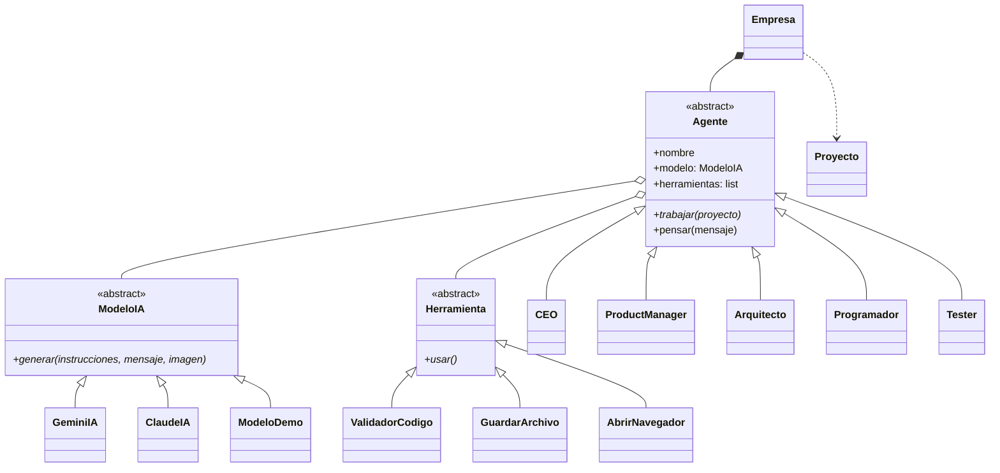

# DevSquad — sistema multiagente de desarrollo de software

Proyecto de **Programación Orientada a Objetos** (POO - CIB - 07:00, Universidad de Guadalajara).

Le cuentas una idea a la "empresa" (en texto o con la **foto de un boceto**) y
5 agentes de IA con roles distintos colaboran para convertirla en un **juego o app que funciona**,
que se abre ahí mismo para probarlo.

```
Cliente (texto o foto)
   ↓
Valeria — CEO                  → entiende la idea y define el alcance
   ↓
Marco — Product Manager        → historias de usuario y criterios de aceptación
   ↓
Sofía — Arquitecta          → diseña las clases (diagrama UML que se dibuja en pantalla)
   ↓
Diego — Programador         → escribe el código (un archivo HTML)
   ↓
Lucía — Tester              → lo revisa con su herramienta; si falla, se lo regresa a Diego
   ↓
Se guarda en proyectos/ y se puede jugar en la página
```

## ¿Qué problema resuelve?
Pasar de una idea a un prototipo normalmente requiere a varias personas (quien entiende al cliente,
quien escribe requisitos, quien diseña, quien programa y quien prueba). DevSquad IA automatiza ese
proceso con agentes que se pasan el trabajo como en una empresa real, y se corrigen entre ellos.

## Cómo instalarlo
Requisitos: **Python 3.10 o más nuevo**.

```bash
git clone https://github.com/Alvaroaprendiz/DevSquad-IA.git
cd DevSquad-IA
pip install -r requirements.txt
```

### API key (gratis)
1. Entra a <https://aistudio.google.com> → **Get API key** → **Create API key**.
2. Copia `.env.example` como `.env` y pega tu key en `GEMINI_API_KEY=`.

> El `.env` está en `.gitignore`: la key **nunca** se sube a GitHub.
> Sin key el sistema funciona en **Modo demo** (respuestas preparadas, sin internet), útil como respaldo.

## Cómo usarlo
**Página web (recomendado):**
```bash
streamlit run app.py
```
Se abre en el navegador. Escribe tu idea (o sube la foto de la servilleta) y presiona
**Iniciar proyecto**. En la pestaña **Arquitectura del sistema** está el diagrama de clases del sistema.

**Con un dibujo:** sube la foto de la hoja en **Foto del dibujo** (o activa **Tomar la foto con la
cámara**) y presiona **Iniciar proyecto**. Lo que escribas en la hoja (por ejemplo "crea un juego de...")
se toma como la instrucción y el dibujo como la guía visual.

**Consola:**
```bash
python main.py "un juego donde atrapo estrellas y esquivo bombas"
```

## Publicarlo en internet (Streamlit Community Cloud)
1. Entra a <https://share.streamlit.io> con tu cuenta de GitHub y crea una app desde este repositorio (`app.py`).
2. En **Advanced settings → Secrets** pega:
   ```toml
   GEMINI_API_KEY = "tu-key"
   GEMINI_MODEL = "gemini-3.5-flash-lite,gemini-3.1-flash-lite,gemini-3.5-flash"
   ```

## Diseño (POO)
```
devsquad/
├── agentes.py      Agente (abstracta) → CEO, ProductManager, Arquitecto, Programador, Tester
├── modelos.py      ModeloIA (abstracta) → GeminiIA, ClaudeIA, ModeloDemo
├── herramientas.py Herramienta (abstracta) → ValidadorCodigo, GuardarArchivo, AbrirNavegador
├── empresa.py      Empresa: tiene a los 5 agentes y coordina el trabajo
├── mensajes.py     Mensaje y Proyecto (dataclasses)
└── demo.py         respuestas del modo demo
app.py              página web (Streamlit)
main.py             versión de consola
```

| Concepto | Dónde se usa |
|---|---|
| **Clase abstracta** | `Agente`, `ModeloIA` y `Herramienta` definen *qué* se hace; las hijas definen *cómo*. |
| **Herencia** | Los 5 roles heredan de `Agente`; `GeminiIA`/`ClaudeIA`/`ModeloDemo` de `ModeloIA`. |
| **Polimorfismo** | La `Empresa` solo llama `agente.trabajar(proyecto)`; cada rol hace algo distinto. Lo mismo con `modelo.generar(...)`. |
| **Composición** | La `Empresa` tiene 5 agentes; cada `Agente` tiene un `ModeloIA` y una lista de `Herramienta`. |
| **Encapsulamiento** | Cada agente guarda sus instrucciones (personalidad) y solo expone `trabajar()`. |
| **Módulos** | Cada parte del sistema está en su propio archivo dentro del paquete `devsquad`. |



## Herramientas que usan los agentes
- **Validador de código** (Tester): revisa que el HTML esté completo y que el JavaScript no tenga
  errores de sintaxis (con `node --check` si está instalado Node, o revisando llaves y paréntesis).
- **Guardar archivo**: guarda el resultado en `proyectos/`.
- **Abrir en navegador**: abre el juego terminado (versión de consola).
- **Visión**: el CEO puede leer la foto de una servilleta (Gemini y Claude aceptan imágenes).

## ¿Por qué agentes + POO y no solo POO?
Con POO tradicional tendríamos que programar a mano cada juego posible. Con agentes, la POO nos da
la **estructura** (roles, herencia, composición, herramientas intercambiables) y la IA pone la
**flexibilidad**: el mismo sistema construye un juego de estrellas, una calculadora o un quiz
sin cambiar una línea de código. Y como cambiar de proveedor es solo cambiar el objeto `ModeloIA`,
el sistema no depende de una sola empresa de IA.

## Herramientas gratuitas
- Gemini API (capa gratuita de Google AI Studio)
- Streamlit, Python, Mermaid (diagramas)
- Claude es opcional (su API es de pago).

## Equipo
- Álvaro Joseph Ramírez Pulido
- Samuel Zareth Nuño Cisneros
